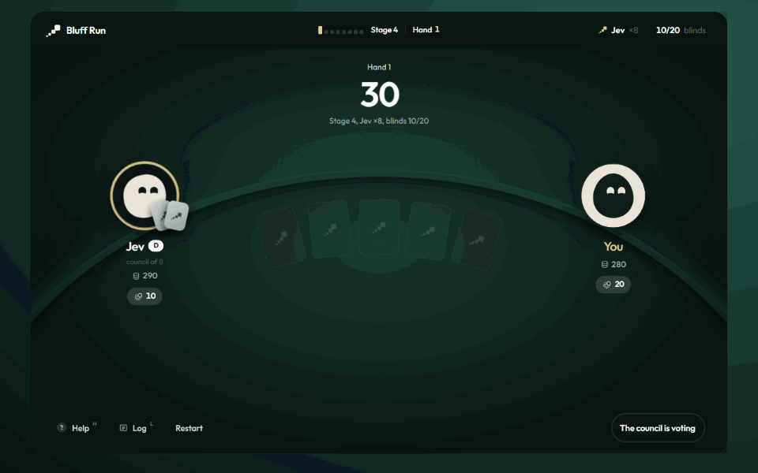

# Bluff Run

**How many Jevs can you beat?**



Heads-up no-limit Hold'em against a council of AI players that vote on every move. Beat one, and next hand there are two of them in the chair. Then 4, 8, 16, 32, 64, 100.

Live at [bluff-run.win](https://bluff-run.win).

## How it works

- **One seat, many Jevs.** Every stage is heads-up. The seat across from you is acted by N copies of [Jev](https://openrouter.ai/typesafe/jev-latest), the TypeSafe decision model, reached through OpenRouter. Each member reads the same table and answers in parallel. The seat does what the plurality says, and the vote fills in live beside it.
- **Seeded personalities.** Members are drawn per council from seven archetypes (Plain Jev, Rock, Station, Grinder, Hustler, Maniac, Clock), with quirks from stage 4, tells from stage 5 and tilt after a big loss. A solo Jev acts on its own top choice; council members sample from their probabilities, so the variety comes from the members.
- **Same council for everyone.** The deck is seeded with the council. Everyone gets the same daily council, a run can be shared as a link, and the recipient faces the same Jevs and the same cards.
- **Nothing leaks mid-hand.** What the council thought stays hidden until the run ends. Then you get every decision with its vote, and the reveal of each member you faced.

Stacks start at 300 with 10/20 blinds rising every 4 hands, so a stage takes a few minutes.

## Run it locally

```bash
npm install
cp .env.example .env.local   # add OPENROUTER_API_KEY
npm run dev
```

`BLUFF_MOCK=1` runs the table without network calls, with persona-flavoured random votes. With it, `?stage=N` on the play page jumps to a stage.

### Checks

```bash
npm test                        # engine, council determinism, share codec
BLUFF_MOCK=1 npx next start -p 3100
node scripts/e2e.mjs            # scripted play-through
node scripts/shots.mjs          # screenshots of every screen
node scripts/council-shots.mjs  # the vote strip and the reveal
node scripts/pace.mjs           # times a stage, use against a real-key server
```

## Deploy

Vercel, no config. Import the repo, set `OPENROUTER_API_KEY` and `NEXT_PUBLIC_SITE_URL` (the public URL, used for share links and the Open Graph card), deploy. The council route only answers same-origin requests from the table, allows 100 members per request and 60 seconds per call.

## Layout

```text
src/engine      hand evaluator, betting rounds, side pots
src/game        run constants, council builder and tally, hand records, share codec
src/brains      the Jev prompt and the OpenRouter System One call
src/components  table window, bots, arena driver, results and review
src/app         landing, play, the Jevs guide, share pages and the council route
```

## Built with

Next.js 16, React 19, TypeScript, vanilla CSS, Playwright for the scripted checks. Characters are spring-driven SVG bots. No UI kit.

## License

MIT. Built by [Abdullah Naseem](https://github.com/abdullah270602).
